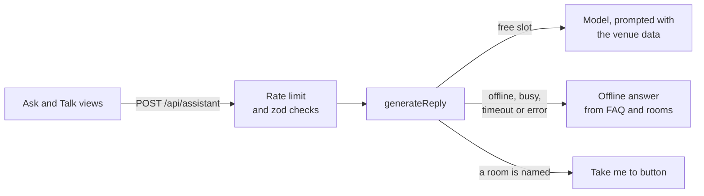

# Architecture

The kiosk is the screen app of Taksu Tech's reception robots: one Next.js app for the 13.3-inch
landscape screens on Snow and Timo and the 24-inch portrait totem of the Taksu Kiosk, a static
kiosk Taksu Tech builds itself. Each screen runs locked to this one full-screen app. It lives at
`apps/kiosk` in the [TaksuTech](https://github.com/DarmawanWeb/TaksuTech) workspace and reads
the robots and the venues from `@taksu/content`.

## Stack

| Part | Choice |
|---|---|
| Framework | Next.js 16, App Router, Turbopack, `output: 'standalone'` |
| UI | React 19, Tailwind CSS 4, the components and reception theme (`theme.css`) from `@taksu/ui`, lucide icons |
| Languages | next-intl 4, `/id` (default) and `/en`, prefix always present; times in WITA (`Asia/Makassar`) |
| Data | `@taksu/content`: robots and sample venues as TypeScript objects; no database |
| Bali | `@taksu/bali`: Aksara Bali transliteration, Balinese numerals, greetings, the Pawukon calendar |
| Server | Route handlers in `src/app/api`; `src/server` for the AI providers, rate limiter, and speech client; zod 4 checks request bodies and the `AI_*` settings |
| Printing | CSS print rules for 80 mm thermal paper; QR codes from `qrcode`, generated in the browser |
| Fonts | Plus Jakarta Sans (text), Bricolage Grotesque (display), Noto Serif Balinese (aksara), self-hosted through Fontsource |
| Tests | Vitest: assistant and providers, speech client, rate limiter, queue, guest book, wayfinding, Studio, messages |

The build tracing root is the workspace root (`next.config.ts`), so the standalone output carries
the shared packages, which Next.js transpiles from source.

## Routes

Pages live under `src/app/[locale]/` and are prerendered for both languages and every robot and
venue (`generateStaticParams`, `dynamicParams = false`). Unknown robots, venues, and paths
(`[...rest]`) get the localized not-found page. `src/proxy.ts` runs the next-intl middleware on
everything except API routes and files. Only the launcher is indexed.

| Path | Screen |
|---|---|
| `/` | Launcher: every robot at every sample venue, the robot's own venue marked as recommended; the totem preview; Studio. Its logo, with the reception line's name, links back to the robot site |
| `/<robot>/<site>` | The kiosk screen: `snow`, `timo`, or `kiosk` at `kantor-layanan` or `resort` |
| `/<robot>/<site>/preview` | The kiosk screen at 1080 x 1920 in an iframe, inside a drawing of the totem (crown, bezel, printer, base), scaled to the window. A phone held upright opens the kiosk screen itself |
| `/studio` | Studio: pick a robot, type an organisation name and a tagline, choose a sample venue and the menus, and see the nameplate in Aksara Bali as you type. Opening saves the settings in this browser |
| `/<robot>/custom` | The kiosk built in Studio: the chosen sample venue under the new name, still labelled as sample data, with only the chosen menus. The assistant uses the new name too |

## The kiosk screen

`features/kiosk/kiosk-app.tsx` is a small state machine of views around the robot's face:

- **Waiting** (`idle-screen.tsx`): the face between the two halves of a candi bentar (`gate.tsx`),
  under the venue's nameplate and above Om Swastiastu in Aksara Bali. A touch anywhere starts in
  the current language. Each of the two start buttons starts in its own language; the one for the
  other language reopens the screen in that locale with `?view=home&greet=1`, and the robot greets
  on arrival.
- **Menu** (`home-menu.tsx`): the first four menus as large tiles (Talk, Queue, Guest book,
  Directions), the rest in a row below.
- **A feature view**, under its menu button's title and line. As it opens, the robot says what
  the screen is for.

The face has five moods: waiting, listening, thinking, speaking, and happy. The open view and the
chosen room live in the address bar (`?view=`, `?room=`, through `history.replaceState`), and the
language toggle carries the query string along, so a language switch or a reload lands on the
same screen. After 90 seconds without input the visit ends and the waiting screen returns.

The app never asks which screen it runs on: the layout follows the orientation and the size
follows the short side (see [design rules](development.md#design-rules)). In landscape, the clock
and controls sit beside the nameplate, and the face, its speech bubble, and the menu button form a
left column beside the content. In portrait, the nameplate, face, and content stack from the top,
and the menu button, clock, and the sound, language, and full-screen controls sit in a dock at the
bottom. The clock shows WITA and today's Pawukon day, or the holy day's greeting.

## Robots and venues

`@taksu/content` holds both. A robot brings its name, greeting, tone, browser voice (pitch and
rate), and whether it can walk a guest to a room. A venue (`KioskSite`) brings everything the
screens and the assistant say about it: name, tagline, profile, facts, the organisation tree,
queue services, the floor map (nodes, corridors, rooms, the robot's start), the FAQ with keywords
for offline answers, and notes on customs. The two venues, `kantor-layanan` (a public-service
office) and `resort`, are samples (`isSample`), and the screen labels them as such.

| | Snow | Timo | Taksu Kiosk |
|---|---|---|---|
| Screen | 13.3-inch, landscape | 13.3-inch, landscape | 24-inch, portrait |
| Theme | Light | Dark | Dark |
| Directions | Offers to walk the guest there | Offers to walk the guest there | Prints a route slip with a QR code |
| Recommended venue | `resort` | `kantor-layanan` | `kantor-layanan` |

## Feature folders

| Folder | Does |
|---|---|
| `kiosk/` | The screen and its views, the waiting screen and gate, the nameplate (`signboard.tsx`), header, dock and controls (sound, language, full screen), the WITA clock with the Pawukon day, the idle timer, browser speech (`speech.ts`) |
| `voice/` | The Talk menu: push to talk, recording, server speech to text and text to speech, the loudness store behind lip-sync |
| `assistant/` | The Ask menu: a text chat with the venue's first four FAQ questions as suggestions; `ask.ts` calls `/api/assistant` for chat and voice alike |
| `queue/` | The venue's services with their counter and average minutes; tickets numbered per service and per Bali day |
| `guestbook/` | Registration (name, origin, purpose, host) and the visitor pass, numbered per Bali day (`TM-20261007-007`) |
| `wayfinding/` | Shortest route (Dijkstra) from the robot's spot to a room's door, turn-by-turn steps in metres, minutes on foot at 1.2 m/s, the SVG floor plan, the escort animation, the route slip, the steps read aloud |
| `about/` | The venue's tagline, profile, and facts |
| `organization/` | The organisation chart; a member's room, with a button that opens directions to it |
| `aksara/` | A name typed in Latin, shown in Aksara Bali as it is typed, printed as a keepsake |
| `culture/` | Om Swastiastu and the venue's notes on Balinese customs |
| `print/` | The thermal slip, its Aksara Bali header, QR images |
| `preview/` | The totem frame around the portrait screen |
| `studio/` | The Studio form, its saved settings, and the custom kiosk built from them |

Nothing a visitor types is stored on the server. Queue counters
(`taksu-kiosk:queue:<site>:<day>`), pass numbers (`taksu-kiosk:guest-seq:<site>:<day>`), and the
Studio settings (`taksu-kiosk:studio`) live in `localStorage`, guarded so that blocked storage
still issues the ticket or pass. Counters start again each day in Bali time.

## The assistant

- **Grounding** (`server/ai/prompt.ts`). The system prompt names the robot and the venue, sets the
  robot's tone and the reply language, and asks for at most three short sentences without lists
  or markdown, since replies are read aloud. It lists the venue's profile, facts, rooms, queue
  services, people, FAQ, and customs, and tells the model to answer only from them and never
  invent names, phone numbers, prices, or schedules.
- **Providers** (`server/ai/providers/`), each a plain `fetch` with no SDK:

| `AI_PROVIDER` | Calls | Notes |
|---|---|---|
| `offline` (default) | Nothing | Best FAQ match on keywords and question words, then a named room, queue words, thanks, or a greeting; otherwise three FAQ topics and a pointer to the staff |
| `ollama` | `/api/chat`, not streamed | Sends `keep_alive` so the model stays loaded between visitors; default model `taksu-asisten` at `http://127.0.0.1:11434`; strips `<think>` blocks |
| `anthropic` | Messages API, `/v1/messages` | Needs `AI_API_KEY`; default model `claude-haiku-4-5-20251001` |
| `openai` | `/chat/completions` on any OpenAI-compatible API | Needs `AI_MODEL`; `AI_BASE_URL` points it at OpenRouter, Groq, vLLM, and the like |

- **Fallbacks.** Each model call gets `AI_TIMEOUT_MS`; a timeout or an error returns the offline
  answer. A setup that cannot work (Anthropic without a key, OpenAI-compatible without a model,
  an invalid value) runs offline and logs a warning. The chat marks offline replies.
- **Concurrency.** At most `AI_MAX_CONCURRENCY` model calls run at once in a server process; the
  next visitor gets an offline answer straight away instead of waiting.
- **Rate limit** (`server/rate-limit.ts`). A sliding window in memory per visitor IP
  (`cf-connecting-ip`, else the first `x-forwarded-for`): `ASSISTANT_RATE_LIMIT` questions a
  minute, then 429 with `retry-after`, and the kiosk asks the visitor to wait a moment.
- **Rooms** (`server/ai/intents.ts`). A question that names a room, or a synonym such as restroom
  or kolam, gets a `navigate` action: a "Take me to" button that opens directions.

## Voice

The optional [speech service](https://github.com/DarmawanWeb/reception-robot-speech) runs Whisper
(speech to text) and Piper (text to speech) at `SPEECH_URL`. The kiosk asks `/api/speech/health`
once when the screen loads; the server asks the service and keeps the answer for 30 seconds.
While the service downloads its models on first start, the answer is false and the kiosk uses the
browser's voice and recognition.

- **Speaking** (`say` in `kiosk-app.tsx`). With a server voice for the language, `/api/tts`
  returns WAV, played through Web Audio. An analyser writes its loudness every frame to a small
  store (`voice/level-store.ts`) that only the face reads, so the mouth follows the real voice
  (lip-sync) without re-rendering the screen. Otherwise `speechSynthesis` speaks in `id-ID` or
  `en-US` with the robot's pitch and rate. With neither, the face plays its talking animation for
  a time set by the length of the line. The sound button silences the robot.
- **Listening** (`voice/voice-view.tsx`). Push to talk. With server speech to text, the
  microphone records for up to 8 seconds and `/api/stt` returns the text; otherwise the browser's
  `SpeechRecognition` takes one sentence; without either the visitor types. The text goes to the
  assistant like a typed question, and the reply is spoken.

## Printing

Queue tickets, visitor passes, route slips, and name keepsakes print on 80 mm thermal paper with a
72 mm print width. `features/print/print-slip.tsx` shows each slip leaving a printer, black on
white in either theme, and heads it with the venue's name in Aksara Bali above the Latin.

| Slip | Printed from | Carries |
|---|---|---|
| Queue ticket | Queue | The code, also in Balinese numerals; service and counter; people ahead and the estimated wait; a QR code; the time it was taken |
| Visitor pass | Guest book | The name in Aksara Bali and Latin, origin, purpose, host and their room, a QR code, the pass number, the check-in time |
| Route slip | Directions, on the Taksu Kiosk | The room in Aksara Bali and Latin, the steps, a QR code that opens the route (`?view=wayfinding&room=`) |
| Name keepsake | Aksara | The name in Aksara Bali and Latin, and the date |

Printing is the browser's `window.print()`. The `@media print` rules in `src/app/globals.css` hide
everything but `.print-slip` and lay it out 72 mm wide with 4 mm on each side, no page margin, and
a 12 px root size, without the on-screen shadow and slide-out. `qrcode` makes the QR codes in the
browser as data URLs, with no outside service; the pass QR holds a compact JSON payload
(`t: 'taksu-pass'`, pass id, venue, name, host, time).

## Aksara Bali

`transliterate()` from `@taksu/bali` writes Latin as Aksara Bali by rule, for names and short
phrases: a plain `e` reads as in Ketut, `é` as in Madé, and digits become Balinese numerals.
`OM_SWASTIASTU` carries its established spelling. `@taksu/ui` renders it (`AksaraText`, and
`NameWriter` for live typing) in Noto Serif Balinese, with the line height stacked vowel signs
need.

- The nameplate (`kiosk/signboard.tsx`) is the papan nama of a Balinese office: the venue's name
  in Aksara Bali above the Latin, as Pergub Bali 80/2018 asks, on the waiting screen, in the
  header, and atop every slip. Its Latin line drops the `é` that only guides the Aksara spelling
  (Désa becomes DESA).
- Queue numbers also appear in Balinese numerals; passes and keepsakes carry the name in Aksara.
- Aksara lines that repeat Latin text on screen are `decorative`, so screen readers skip them.
- Transliteration is automatic. The Aksara screen says so, and asks for a Balinese language
  adviser's review before an inscription or official sign.

## API routes

| Route | Does |
|---|---|
| `POST /api/assistant` | `{ robot, site, siteName?, locale, messages }` (up to 16 turns of 600 characters, the last 10 used; `siteName` is a Studio kiosk's name) to `{ reply, source, action? }`; 400 for a bad body, 404 for an unknown robot or venue, 429 when rate-limited |
| `GET /api/health` | `{ ok, ai, speech }`: the provider in use and whether `SPEECH_URL` is set, for Docker and the monitoring probes |
| `GET /api/speech/health` | `{ stt, tts: { id, en } }` from the speech service, cached for 30 seconds; all false without it |
| `POST /api/stt` | Multipart `audio` (up to 4 MB) and `locale` to `{ text }`, through the service's Whisper; 503 when it fails |
| `POST /api/tts` | `{ text, locale }` (up to 500 characters) to `audio/wav` from the service's Piper; 503 when it fails |

`/api/stt` and `/api/tts` have their own per-IP limits (`STT_RATE_LIMIT`, 20 a minute, and
`TTS_RATE_LIMIT`, 120 a minute). Every limiter lives in memory, one per server process.

## Configuration

The `AI_*` settings are read for each question, the rate limits once per server process, and
`NEXT_PUBLIC_ROBOT_URL` at build time. An invalid `AI_*` value, or a provider without what it
needs, means offline answers.

| Variable | Purpose |
|---|---|
| `NEXT_PUBLIC_ROBOT_URL` | The reception robot site the launcher's logo links back to |
| `AI_PROVIDER` | `offline` (default), `ollama`, `anthropic`, or `openai` |
| `AI_MODEL` | Model name; defaults to `taksu-asisten` (Ollama) and `claude-haiku-4-5-20251001` (Anthropic); required for `openai` |
| `AI_API_KEY` | Key for Anthropic (required) and OpenAI-compatible APIs; not used by Ollama |
| `AI_BASE_URL` | Base URL override; Ollama defaults to `http://127.0.0.1:11434` |
| `AI_TIMEOUT_MS` | Time a model call gets before the offline answer, 15000 by default |
| `AI_KEEP_ALIVE` | Ollama only: how long the model stays loaded after a request, `30m` by default |
| `AI_MAX_CONCURRENCY` | Model calls at once, 2 by default; extra visitors get offline answers |
| `ASSISTANT_RATE_LIMIT` | Questions per visitor IP per minute on `/api/assistant`, 12 by default |
| `STT_RATE_LIMIT`, `TTS_RATE_LIMIT` | Per-IP limits on `/api/stt` and `/api/tts`, 20 and 120 a minute by default |
| `SPEECH_URL` | The speech service; empty means browser speech only |

In the workspace, Docker Compose runs this app as the service `kiosk` behind Caddy, by default at
taksu-kiosk.agus-darmawan.com, where Caddy allows the microphone. Compose sets
`SPEECH_URL=http://speech:8000`, and `infra/ollama` sets up Ollama with the `taksu-asisten` model.
